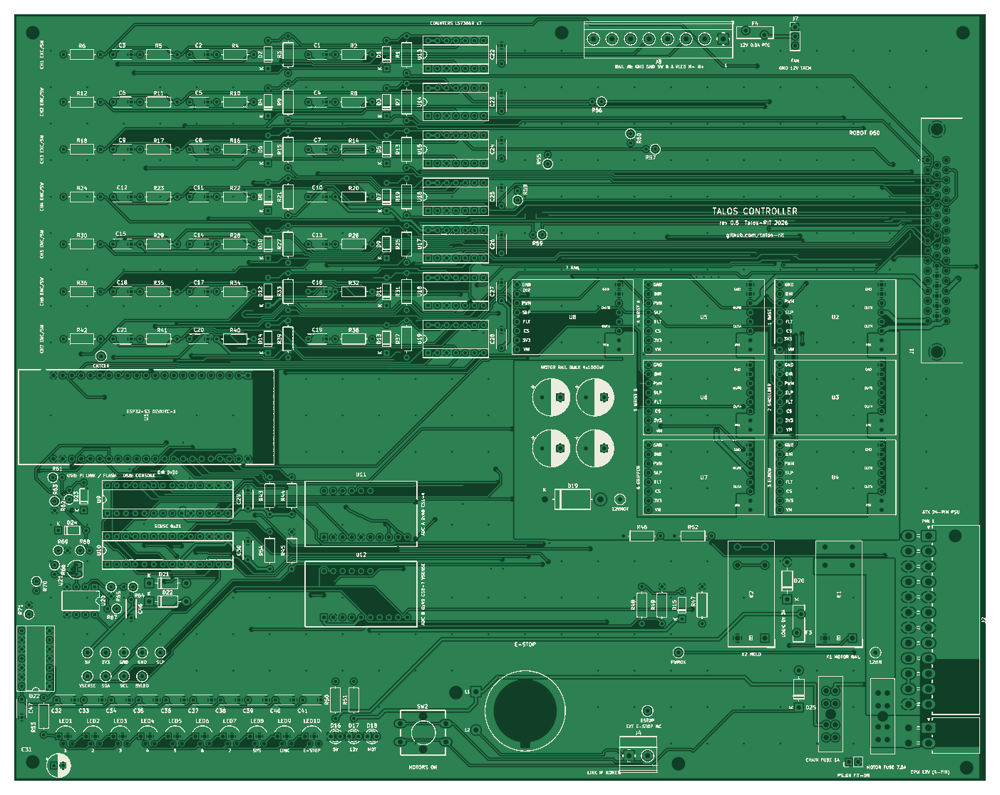

# Talos controller board, rev 0.5

A controller board for the Scorbot ER-V and ER-4pc educational arms (the Talos-RIT project's two robots). It replaces the original
controller box with an ESP32-S3-DevKitC-1 on a 265 × 210 mm two-layer board: seven motor channels on plug-in driver
modules (five arm axes, the gripper, the slide rail; the project's own Talos driver module, or the Pololu G2 18v17 the sockets were drawn for), a hardware quadrature counter (LS7366R) and a current sense on every channel,
power from a standard ATX PC supply, a mushroom e-stop with a MOTORS ON relay chain, and ten status pixels. Every part is
through-hole, so the board can be built by hand or partly by a board house.

The firmware ([talos-rit/esp-driver](https://github.com/talos-rit/esp-driver)) speaks the Eshed controller's own serial dialect over the
DevKit's USB socket, so the Raspberry Pi "operator" software and the Pi image are the same for both robots. A protobuf link for the
ROS 2 stack is a second mode on the same socket, picked in the firmware's configuration or detected from the first bytes.

> **Status, 13 November 2026.** The design is rev 0.5: the reviewed rev 0.4 board with one change, two signals moved to other pins
> of the DevKit socket so that the ESP32 boards still on sale fit (section 8). The first order, from JLCPCB with partial
> assembly, is being prepared. No board has been built or powered yet, and the firmware compiles for the ESP32-S3 but has not run on a chip. Read
> everything here as "designed and reviewed, not yet proven"; the open items are listed at the end, and the first-power procedure
> in section 5 exists because the first board is the first test of the design.



Left to right, top to bottom: the seven channel strips (encoder filters, clamps and the LS7366R counters U13 to U19) across the top;
the rail terminal J8, the fan header J7 and its fuse F4 on the top edge; the DevKit socket U1 at the lower left with the I/O
expanders U9, U10 and the ADC boards U11, U12 beside it; the seven driver sockets U2 to U8 in the centre with the motor-rail
capacitors C42 to C45; the 50-pin robot connector J1 on the right edge; the relays K1, K2, the fuses F1, F2 and the ATX headers J2, J3 at
the lower right; the status pixels, the lamps, the MOTORS ON button SW2, the e-stop cut-out and the external e-stop terminal J4 along the
front edge.

## What is in this folder

| File | What it is |
| --- | --- |
| `README.md` | this guide |
| `parts.md` | the parts list by vendor, with quantities and the substitution rules |
| `fab/scorbot_controller_rev0.5_gerbers.zip` and `.sha256` | the manufacturing files (Gerbers and drill files): the zip to order from |
| `fab/jlcpcb_bom.csv`, `fab/jlcpcb_cpl.csv` | the BOM and placement files for JLCPCB's assembly service |
| `fab/hand_assembled.csv` | the parts JLCPCB does not place: what you fit yourself, and why |
| `fab/digikey_upload.csv` | the Digi-Key list, ready for "Upload a list" |
| `purchase_options.md`, `orders/` | three ways of ordering the boards, assembled or bare, with what each costs (carts of 18 November 2026) and the parts list of each cart |
| `schematic.pdf` | the schematic |
| `assembly_map.pdf`, `assembly_map.svg` | every footprint with its reference designator and orientation marks, and a legend of what goes where |
| `images/` | the board's top and bottom views |
| `kicad/` | the KiCad project: board, schematic, the project's symbol and footprint libraries. KiCad 7 format; KiCad 8, 9 and 10 open and upgrade it |

The design document behind the board, with the pin map, the channel design and the firmware's behaviour rules, is
`technical/ros2/esp_controller_design.md` in the project documentation (section 8 describes this board).

## What you need

- Through-hole soldering: about 36 parts to fit yourself (about 200 joints), plus the plug-in modules. A board house does the rest.
- A multimeter, a bench power supply with an adjustable current limit, and a clamp meter for the driver check.
- M3 hardware and standoffs of 15 mm or taller (the e-stop body reaches 12.6 mm below the board); the list is in `parts.md`.
- An ATX PC power supply with a 24-pin main lead and a 4-pin "CPU 12 V" lead.
- A computer with ESP-IDF v5.5.3 to build and flash the firmware, and two micro-USB **data** cables.
- A Raspberry Pi running the operator (the existing Talos-RIT stack), or a PC with the ROS 2 stack.

## 1. Order the board

Upload `fab/scorbot_controller_rev0.5_gerbers.zip` to JLCPCB as it is. Check the sha256 against `fab/scorbot_controller_rev0.5_gerbers.zip.sha256`
first if you copied it around. The options that matter:

| Option | Choose |
| --- | --- |
| Layers, size | 2 layers; 265 × 210 mm is read from the files (type it if the form still shows a default) |
| Material, thickness | FR-4 TG135, 1.6 mm |
| Copper | 1 oz outer copper (the design was checked at 1 oz; 2 oz is also fine with these files) |
| Surface finish | lead-free HASL. Not OSP: the hand-fitted parts are soldered weeks after the boards arrive |
| Colour | any; the white silkscreen on green is the most legible |
| Vias | tented, minimum via 0.3 mm (the design uses 0.4 mm drills) |
| Confirm production file | yes. Expect two remarks: the silkscreen text is 0.8 mm high, under JLCPCB's printed 1.0 mm minimum (accept it; it prints, a little less crisp), and three pads of U21 have an annular ring of exactly 0.20 mm, their minimum |
| Quantity | 5 is the minimum; spares are useful |

**Assembly.** Tick PCB assembly, top side, through-hole. Upload `fab/jlcpcb_bom.csv` as the BOM and `fab/jlcpcb_cpl.csv` as the
placement file. Choose "Economic" (it covers single-side through-hole boards of this size), tooling holes added by JLCPCB, **Confirm
parts placement = Yes** (you get a preview to check every polarised part: the diodes' bands, the electrolytics' stripes, the lamps,
the socket notches, the relays), board cleaning = No (the MOTORS ON switch is not washable), and add this assembly remark:

> All parts are through-hole, top side. Designators JH3-JH20 are 2.54 mm female header strips whose footprints have no pads on purpose:
> each strip is soldered into the holes of the module footprint under it (JH3-JH16 under U2-U8, JH17-JH20 under U11 and U12). Do NOT wash
> or clean the boards after soldering: SW2 (Omron B3F-4055) is not washable.

At the BOM step JLCPCB matches each line to its catalogue by the code in the file; one line, J4, has to be selected by hand (click its Search, enter `C480516`, Select), a quirk of their matcher with that part. A line it cannot match or has no stock for is simply left unticked: that
part moves to your own list (the fallback lines in `parts.md`). Two things to know: the BOM has the same resistor on two lines where it
is fitted flat and upright, which JLCPCB flags as a duplicate (tick both); and a few parts on the BOM are substitutes for the design
part that were accepted on their datasheets, which `fab/jlcpcb_bom.csv` names line by line.

## 2. Order the parts

What a whole order costs, with the boards assembled or bare, is in [`purchase_options.md`](purchase_options.md).

`parts.md` has everything by vendor: Digi-Key (upload `fab/digikey_upload.csv`, then delete the fallback lines you do not need),
the driver modules (five for the arm or seven for all channels: the Talos driver module in [`../talos_driver_module/`](../talos_driver_module/README.md),
designed and reviewed but not yet built or tested, or the Pololu G2 18v17 it replaces, which fits the same sockets), Adafruit and SparkFun (on the Digi-Key list), and
the supply, cables and hardware from anywhere. The rules that must not be broken when substituting are at the end of that file; the
three most important: the DevKit is never a variant ending in **V**, D20 and D25 are silicon rectifiers and never Schottkys, and F2 takes a
**1 A** blade fuse, never the 7.5 A of F1.

## 3. Assemble

Everything is on the top side. `assembly_map.pdf` shows every designator and the orientation marks; `fab/hand_assembled.csv` lists
what you fit yourself and why. On a board JLCPCB has populated, fit in this order:

1. **The D-sub J1, the ATX headers J2 and J3, and the two 1×22 strips JH1, JH2** (the DevKit socket). The strips set the DevKit's
   position: solder two end pins first, check the DevKit seats, then the rest. Before the DevKit goes in for good, look at the
   solder side between the IO47 and IO48 pins: the DevKit's 5 V feed runs between them, 0.27 mm from each pad, and a solder bridge
   there puts 5 V on a 3.3 V pin. Check with a meter that the socket's 5V pin has no continuity to IO47 or to IO48 (a bridge reads
   under an ohm, the circuit itself tens of kΩ or more). IO47 and IO48 are the sixth and seventh pins from the USB end of the row
   that reads G, G, 19, 20, 21, 47, 48; the 5V pin is the second from the USB end of the other row (`assembly_map.pdf` prints the
   pin names).
2. **The Schottky clamps D1 to D14, D23, D24** (BAT85, band at the K mark on the silk), and the upright resistors **R61, R64, R65**.
3. **The pixels LED1 to LED10.** The square pad is pin 1, DIN. Leads 2 and 4 are bent back 2 mm to reach the staggered pads. Check one
   pack's pin order on arrival (DIN, VDD, GND, DOUT along the row; GND and DOUT are the long leads) and light one pixel from a
   current-limited 5 V supply before soldering any.
4. **D22 stays open** until the pixel rail has been measured at first power (section 5). It is a wire link; a 1N5819 goes there instead
   if TP13 reads above 5.25 V.
5. Whatever JLCPCB could not place (your fallback lines), then the test loops TP1 to TP14 if you want them.
6. **The e-stop SW1, last among the soldered parts:** push it through the cut-out from the top with the notch at the front, tighten the
   locking ring underneath (IDEC wrench MT-001, 0.8 to 0.9 N·m), then solder two 25 mm leads from its lugs 11 and 12 to the two pads
   beside it on the bottom side.
7. **Sockets and modules:** the seven LS7366R counters into U13 to U19 and the 74HCT125 (or 74AHCT125) into U22, notch to the dot; the DevKit into
   JH1/JH2; the driver modules into their two strips each; the two ADS1015 boards into JH17 to JH20. Seat every driver module with
   the motor rail off and check that no pin hangs outside its strip: the power pins are doubled, so a module shifted by one pin
   joins the 12 V rail to ground through them, and a module turned round still fits and puts the rail on its logic side.
8. **On every Pololu G2**, if those are the drivers fitted, before any motor is connected: a 10 kΩ resistor between the module's VREF pad and the GND pad beside it,
   leads trimmed flush underneath. It sets the hardware current limit at about 3.7 A (the module's default is 40 A). Never less than
   10 kΩ, and never 15 kΩ on the rail's module. The Talos driver module has its current limit on board and takes no resistor.
9. The fuses: 7.5 A into F1 (motor rail), 1 A into F2 (the e-stop chain). The key top onto SW2. The shunt onto JP1 (fitted = the supply
   turns on with its mains switch).
10. **J4, the external e-stop terminal.** With no external button, a link: 30 mm of solid 20 AWG wire, one end in each clamp, both screws
    tight, tug-tested. With a button, its NC pair goes in the same two clamps instead, one wire per clamp, never a wire and the link
    together. Without either, MOTORS ON does nothing, which is intended.
11. **Mounting:** seven M3 pan-head screws with DIN 125 washers at H1 to H4 (corners), H9, H10 (beside the e-stop) and H11 (mid back),
    with a nylon washer or none at H10 and H11 where copper is close; M3 screws and nuts at the D-sub bracket holes SH1 and SH2,
    nylon at SH1; standoffs 15 mm or taller.

## 4. Firmware

```bash
git clone https://github.com/talos-rit/esp-driver
cd esp-driver
idf.py set-target esp32s3
idf.py menuconfig        # "Talos ESP Driver Configuration": the defaults are this board; pick the link mode
idf.py build
idf.py -p /dev/ttyUSB0 flash     # the DevKit's "UART" micro-USB socket, the same one the Pi uses
idf.py -p /dev/ttyACM0 monitor   # the DevKit's "USB" micro-USB socket: the console and the logs
```

Port names differ by operating system. The link mode in menuconfig is the Eshed dialect at 9600 baud (the default, for the
operator), the protobuf link at 921600 (the ROS 2 hardware interface), or auto, which starts at 9600 and switches when the first
bytes are not text. The firmware's behaviour (homing, soft limits, the watchdog that stops motion when the link goes quiet, the
fault rules) is tested on a PC against a simulator before it touches hardware: `test/host` in the firmware repository.

One commissioning step, once per DevKit and irreversible: the chip's ROM prints a boot log on the UART socket at every reset, which
reaches the Pi as a burst of bytes. Burning the eFuse `UART_PRINT_CONTROL` to 3 silences it:
`espefuse.py --chip esp32s3 -p <UART port> burn_efuse UART_PRINT_CONTROL 3`.

## 5. First power, in order

Nothing is enabled, homed or connected to a robot before these pass. Test points: TP2 is the motor rail, TP3 the 5 V rail, TP8 the
e-stop loop, TP13 the pixel rail (all labelled on the silk).

1. **Continuity, supply off, nothing plugged in.** K2 pin 13 to pin 14: no continuity. J4 pin 1 to pin 2 with J4 empty: no continuity.
   A beep on either is a solder bridge in the e-stop chain: find and clear it before anything else.
2. **The supply-sense circuit, unpowered**, with F3 out and no encoder cable: about 0.81 kΩ from the 5 V rail to ground; D23 and D24
   read 0.2 to 0.3 V forward; U21 reads 0.5 to 0.7 V from K to ground in diode mode one way and nothing the other way.
3. **USB power only** (the Pi or a PC on the UART socket, ATX off): the reference `5V_SENSE_REF` reads 1.240 V ±2 %; TP3 under 0.05 V.
4. **The trip sweep**, on every board: ATX unplugged, robot cable off, F3 out, a bench supply current-limited to 100 mA on TP3. Step
   the supply from 5.5 V down to 3.0 V and back in 50 mV steps while watching IO48 and IO38 (a meter on the DevKit's pins; the
   firmware does not show them yet). Do it with the DevKit that will stay on the board plugged in: one of the two pins is also
   the data input of that DevKit's own RGB LED (section 8). IO38 must change state at one voltage between 3.86 and 4.35 V, falling and rising, and
   the pair must never read (0, 0). Then sweep to 0 V: IO38 stays high below the trip. Repeat after any rework of R64, R65, R66, U20 or U21.
   This circuit tells the firmware that the encoders' supply is gone when the PC supply is switched off while the Pi still powers
   the logic; the firmware refuses to trust positions until it says "present" again.
5. **The e-stop chain.** ATX on, J4 empty: MOTORS ON does nothing, TP8 and TP2 stay at 0 V. Link (or button) in J4: TP8 reads about
   12 V, MOTORS ON latches, the yellow lamp D18 lights and both relays click. Press the mushroom: the lamp goes out and TP2 falls below
   9 V within 3 s; twist to release: the rail stays off until MOTORS ON is pressed again. With an external button, pressing it must do
   the same. A lamp that goes out while TP2 stays up is a fail.
6. **The pixel rail.** With D22 still open, power the board and read TP13; fit the wire link if it is at or below 5.25 V, a 1N5819
   otherwise. Once the pixel driver exists: every pattern of section 7 shown once, with IO48 and IO38 watched while all ten
   pixels are lit (the pixel current must not disturb the supply sense).
7. **One driver module on the bench**, no arm (a Pololu G2 with its 10 kΩ VREF resistor fitted; a Talos module after the bench tests in its own README): drive a motor against a clamp meter and note the
   current at which the module chops; compare it with the current the firmware reports in the same stall. The firmware's over-current
   detector can miss a chopped stall at full duty, so this number matters.
8. **Bring-up in the firmware's order:** the DevKit alone (without the board it boots into FAULT, but the link answers `ping` and
   `info`); the full board with no robot (UNHOMED; enabling then staying silent trips the watchdog after 200 ms); one motor with its
   encoder and switch (velocity and position modes, homing from both sides of the switch); then the arm.

## 6. Connect the robot

- **J1, the 50-pin D-sub:** the robot's own cable plugs in directly; the pinout is the same for the ER-V and the ER-4pc (the design
  document, section 1.4, has the pin table). Fit the 4-40 screwlocks.
- **J8, the rail:** the slide rail has its own cable ending in a male D9. A pigtail brings it to the eight screw clamps:

  | J8 pin | Signal | D9 pin |
  | --- | --- | --- |
  | 1 | motor + | 1 |
  | 2 | motor − | 9 |
  | 3 | encoder LED supply | 3 |
  | 4 | encoder A | 8 |
  | 5 | encoder B | 6 |
  | 6 | switch | 4 |
  | 7, 8 | ground (encoder and switch return, and the shield) | 5 and the shield |

  The rail is channel 7, so it needs the seventh driver module (U8).
- **Power:** the ATX supply's 24-pin lead into J2 and its 4-pin CPU lead into J3. The 12 V for the motors enters only through J3;
  J2 supplies 5 V and the control signals. With the JP1 shunt fitted the supply turns on with its own mains switch.
- **The Pi:** a USB data cable from the Pi to the DevKit's UART socket. On the Pi it appears as `/dev/ttyUSB0`, which is the
  operator's default serial device, so the operator runs unchanged. The second micro-USB socket is the console; leave it unplugged
  in normal use or connect a PC to read the logs.
- **MOTORS ON:** after power-up the motor rail is off. Press MOTORS ON (SW2) to latch the relays; the yellow lamp D18 shows the rail
  is live. Pressing the mushroom, or opening the external loop at J4, drops the rail; twist the mushroom to release and press MOTORS
  ON again. The firmware refuses to enable motion while the rail is off.

## 7. Indicators

Three lamps need no firmware: **D16** green, the 5 V rail is up; **D17** green, 12 V is present on the e-stop chain (after F2);
**D18** yellow, the motor rail is live (MOTORS ON latched).

The ten pixels, labelled `1 2 3 4 5 6 7 SYS LINK E-STOP` on the silk, are driven by the firmware, and that driver is not written
yet. The planned scheme: SYS green steady = ready, green breathing = motors armed and the loop running, amber = unhomed or a soft
limit, amber blinking = the host watchdog tripped, red blinking = a latched fault, red steady = self-test or calibration failed, blue
blinking = booting. LINK green = the Eshed dialect in use with recent traffic, cyan = the protobuf link, blinking = up but idle.
E-STOP red = the chain is open, amber = closed but MOTORS ON not pressed, green = the rail is live. Each channel: off = disabled in
the configuration, amber = not homed, blue blinking = homing, green = homed, green breathing = moving, red blinking = faulted.

## 8. Open items and known limitations

- **Which ESP32 board.** The board was drawn for the ESP32-S3-DevKitC-1-N8, which Espressif has ended together with the N8R2
  (its user guide marks both EOL; Digi-Key lists the N8 as obsolete, November 2026). The variants still sold carry 8 MB of octal
  PSRAM, which uses GPIO35 to GPIO37 inside the module. Rev 0.5 therefore leaves those three pins unconnected and reads the
  encoder supply sense on IO48 and IO38, so **any ESP32-S3-DevKitC-1 that is not a "...V" part fits**: the N16R8, the N8R8, their
  1U versions (a socket for an external antenna in place of the printed one; the controller does not use WiFi), and the old N8
  and N8R2. A part ending in V (N16R8V, N32R16V) runs IO47 and IO48 at 1.8 V and must not be used. The firmware needs no PSRAM.
- **No spare GPIO.** IO38 and IO48 were the last two free pins of the socket; only the strapping pins (0, 3, 45, 46) are unused.
- **The sense inputs share a pin with the DevKit's own RGB LED** on one DevKit version each: IO38 on v1.1 boards, IO48 on v1.0
  boards. The silk beside the LED says which: "RGB@IO38" or "RGB@IO48" (the part number does not tell: a 1U-N8R8 kit received
  in November 2026 reads RGB@IO38). The LED's data input is a light load and
  the firmware never drives these two pins, so the LED stays dark, or may show a stray colour when the supply sense switches; it
  means nothing. The load on the high-impedance channel (IO48, v1.0 boards) is not in any datasheet figure the team has and has
  not been measured: the trip sweep of section 5, run with that DevKit plugged in, is the check.
- **The 5 V feed between IO47 and IO48.** On the solder side the DevKit's 5 V feed runs between the socket pads of IO47 and
  IO48, 0.27 mm from each, under solder mask. A solder bridge there would put 5 V on a 3.3 V pin: section 3, step 1 has the check.
- **The firmware does not read the supply sense yet** (not yet implemented, design document section 8.3); the trip sweep of
  section 5 checks the circuit with a meter.
- **Nothing has been built.** The first board is the first test of every footprint, of the supply-sense circuit and of the e-stop chain;
  section 5 is written for that. Expect to find something.
- **The firmware has not run on a chip.** It builds for the ESP32-S3 with no warnings and its logic passes the host tests, but the
  device drivers (SPI counters, the expanders, the ADCs) are untested on hardware. A set of fixes from the design review (homing that
  stops on a stalled motor, the supply-sense rules, under-voltage and brake behaviour, timing of the ADC and expander reads) is
  prepared and host-tested but not merged. The pixel driver does not exist yet.
- **Relay inrush.** The four 1000 µF motor-rail capacitors charge through K1's contacts at every MOTORS ON. The team plans a
  make-endurance test on loose relays before trusting the Omron G2RL for it; the inrush-rated G5RL-1A-E-HR DC12 is the drop-in
  alternative if it fails.
- **The current reading at partial duty is unverified.** The firmware assumes the driver's current-sense pin reads 0 V during the PWM
  off-time. If a real module holds its 50 mV offset there instead, the firmware over-reads at low duty. Scope the CS pin of one module
  with PWM low and at 25, 50 and 100 % duty before any motion, and set the firmware's model from what you see.
- **The Talos driver modules are untested first prototypes.** Their limits and open questions are in section 7 of their own README.
- **A Pololu G2 has no over-temperature shut-off** (Pololu's own warning). The current limit and the firmware are the protection.
- **A Pololu G2's current limit is a graph reading.** The 10 kΩ VREF resistor gives about 3.7 A per Pololu's graph with no stated
  tolerance; measure it (section 5, step 7).
- **The rail's switch.** The slide's microswitch read closed at rest on the robot inspected; whether it is normally closed, or the leads
  are simply joined, is unknown. The firmware's switch polarity may need to become a per-channel setting.
- **The ROM boot log** reaches the Pi link at every reset until the eFuse is burned (section 4); whether the operator tolerates the
  burst is untested.
- **The encoder LED current** is set by seven 47 Ω resistors for a true 5 V supply. If the encoder outputs are marginal on your robot,
  39 or 33 Ω are the alternatives (on the Digi-Key list as optional lines).
- **Silkscreen** text is 0.8 mm high, under JLCPCB's printed 1.0 mm minimum; it prints, but small labels may be less crisp.
- **The gripper and the rail** have their channels on the board; the ROS 2 side models the five arm joints first and adds them later.
