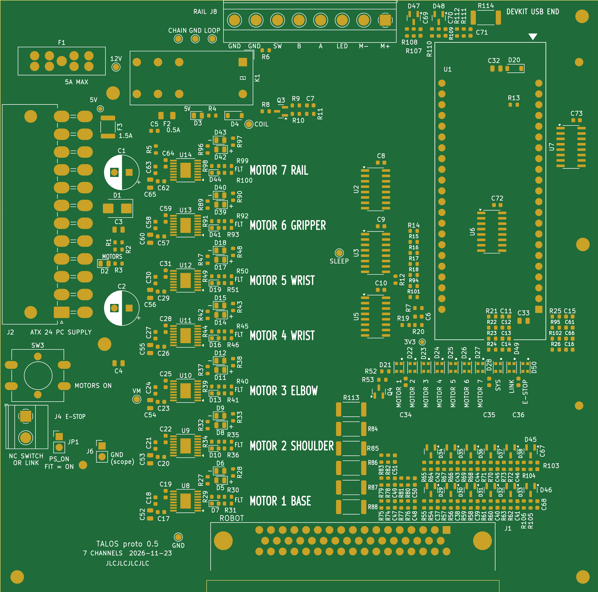

# Talos controller, prototype 0.5

A controller board for the Scorbot ER-V and ER-4pc educational arms (the Talos-RIT project's two robots), built to cost
less than the first Talos controller ([`../talos_controller/`](../talos_controller/README.md)). It drives all seven
motors of the robot (the five arm motors, the gripper and the slide rail) from an ESP32-S3-DevKitC-1 plugged into
sockets, on a 141 × 139.6 mm two-layer board that JLCPCB assembles: seven DRV8874 motor driver chips soldered on, the
encoders counted by the DevKit itself, shift registers and an analogue multiplexer in place of the expander, counter
and ADC chips, power from one 24-pin PC supply plug, and a MOTORS ON relay latch behind an external emergency stop.

The board speaks to the rest of the system through the DevKit's own USB sockets, like the first Talos controller: the
Raspberry Pi "operator" software in Eshed mode (the Eshed controller's own serial dialect), or the ROS 2 stack in
External mode (a protobuf link).

> [!warning] Status, 23 November 2026
> **Designed, checked and reviewed; never built and never powered.** The board passes KiCad's design-rule check with
> no error and nothing unconnected (six explained warnings, section 8), and separate scripted checks of the e-stop
> wiring and of the encoder lines. A separate review pass of the layout found three major and five minor points in
> the copper; all were fixed, and a re-check of the fixed board found nothing that should hold an order. JLCPCB's order page
> has seen these exact files: its parts page matched all 29 parts lines, and its placement preview showed every
> polarised part the right way round. Neither cart on [`purchase_options.md`](purchase_options.md) has been paid.
> **The firmware for this board is not published yet** (section 4). It has run on a chip only as a bench test on a
> bare DevKit: the test of the three software-counted encoders, which passed twice. Everything else (the shift
> registers, the multiplexed current reading, the drivers, the heat, the real encoders' signals) is first seen on the
> first board. Read everything here as "designed and checked, not yet proven"; section 5 exists because the first
> board is the first test of the design.

North is up. Along the west edge: the 24-pin PC supply plug `J2`, the two motor-rail capacitors `C1` and `C2`, the
MOTORS ON button `SW3`, the external e-stop terminal `J4`, the `PS_ON` jumper `JP1` and the ground post `J6`. Along the
north edge: the motor fuse `F1` ("5A MAX"), the relay `K1`, the three e-stop chain test pads (CHAIN, GND, LOOP) and the
rail terminal `J8`. In the middle, the seven drivers in a column, motor 7 at the top (`U14`) to motor 1 at the bottom
(`U8`), each with its fault lamp, its two direction lamps and its name printed beside it. East of them the shift
registers `U2`, `U3`, `U5`; then the DevKit `U1` with its USB end at the north edge, the select register `U6` under it
and the multiplexer `U7` east of it. Below the DevKit the row of ten status-LED positions, then the encoder and switch
blocks, and the 50-pin robot connector `J1` on the south edge.

## How it differs from the first Talos controller

| | First Talos controller, rev 0.5 | **This board, prototype 0.5** |
| --- | --- | --- |
| Board | 265 × 210 mm, two layers, all through-hole | **141 × 139.6 mm, two layers**, surface-mount parts placed by JLCPCB, the through-hole parts (163 joints) fitted by hand |
| Motor drivers | plug-in modules (the Talos driver module or a Pololu G2 18v17) | **one DRV8874 chip per motor, soldered on by the factory**; each limits its own current at 2.93 A (2.75 to 3.2 A over part tolerances) |
| Motor current | set by the module | **about 1.5 A in all seven motors at once without end, about 2 A in one or two** (a heat estimate, section 8) |
| Encoders | one LS7366R counter chip per motor | **the DevKit counts them itself**: four on its pulse counters (motors 1 to 4), three in software (motors 5, 6, 7) |
| Inputs, outputs, ADC | two MCP23017 expanders, two ADS1015 ADC boards | **two 74HC595 and two 74HC165 shift registers** on one SPI bus; the seven motor currents and the rail voltage through **one 74HC4051 multiplexer** into one ADC pin of the DevKit |
| Supply | 24-pin plug for 5 V, the 4-pin CPU lead for the motors, `F1` 7.5 A | **one 24-pin PC supply plug for everything**; the motors' 12 V on its pins 10 and 11; **`F1` 5 A, never more**; the firmware holds the sum of the motor currents to **4 A** |
| Emergency stop | IDEC mushroom on the board, an external loop, two relays | **external e-stop only** (screw terminal `J4`, required), **one two-pole relay**, and the drivers held asleep whenever the relay's coil is off |
| Status lights | ten through-hole pixels | per motor a red fault lamp and a pair of green direction lamps, a 5 V lamp and a motor-power lamp, all placed by JLCPCB; **ten optional 2 × 2 mm status LEDs**, fitted by hand with hot air |
| Encoder supply sense | a comparator on two DevKit pins | a divider on a shift-register input ("5 V present") |
| Firmware | the controller firmware's default board | its own board variant, not yet published (section 4) |

The robot connector `J1` is the same 50-pin socket with the same pin-out for the ER-V and the ER-4pc, and the rail
terminal `J8` is the same 8-way terminal in the same pin order.

## What is in this folder

| File | What it is |
| --- | --- |
| `README.md` | this guide |
| `parts.md` | the parts list: what JLCPCB places, what you fit by hand, the makes that fit |
| `purchase_options.md` | the two carts of 23 November 2026 (JLCPCB and Digi-Key) with every line |
| `fab/talos_controller_lite_proto0.5_gerbers.zip` and `.sha256` | the manufacturing files (Gerbers and drill files): the zip to order from. Its name is the one on the order |
| `fab/jlcpcb_bom.csv`, `fab/jlcpcb_cpl.csv` | the parts list and placement file for JLCPCB's assembly (29 lines, 241 placements) |
| `fab/hand_assembled.csv` | the parts JLCPCB does not place: what you fit yourself, with the solder joints of each |
| `fab/digikey_cart_two_boards.csv` | the Digi-Key list for two boards with spares, ready for "Upload a list" |
| `schematic.pdf` | the schematic: every part with its pins, each pin labelled with its net name |
| `images/` | `print_top.png` and `print_bottom.png` (the printed side as it will look; the bottom as seen from below), `copper_top.png` and `copper_bottom.png` (the two copper layers) |
| `kicad/` | the KiCad project: board, schematic, project file, the footprints drawn for this board and their library table. KiCad 7 format; later versions open and upgrade it |

The KiCad files keep the project's working name, `talos_controller_lite`. The schematic is generated: each part is
drawn as a pin table with net labels, not as a drawn circuit.

## What you need

- **The two orders** on [`purchase_options.md`](purchase_options.md): JLCPCB (boards, the surface-mount parts and their
  assembly) and Digi-Key (the through-hole parts). Both are for two complete boards with spares.
- **Hand soldering:** twelve through-hole positions a board (the DevKit's two socket strips counted as one), 163 joints. No surface-mount soldering is needed unless you fit
  the optional status LEDs. A multimeter; a bench supply with a current limit helps for the checks of section 5.
- **An ATX PC power supply** with a 24-pin main lead. The 4-pin CPU lead is not used.
- **An external emergency-stop button** with a normally closed contact and its cable, for `J4`. The board has no stop
  button of its own (section 6).
- **For the rail:** an adapter from the rail cable's D9 plug to bare wires for `J8`, or the plug cut off (section 6).
- **Six M3 screws and standoffs** for the six mounting holes, with plain or nylon washers on the top side (no toothed
  lock washers).
- A computer with ESP-IDF v5.5.3 to build and flash the firmware, and two micro-USB **data** cables.
- A Raspberry Pi running the operator, or a PC with the ROS 2 stack.

**Not in the carts, and needed:**

- **One ESP32-S3-DevKitC-1 per board.** Any variant that is not a "...V" part fits: N8, N8R2, N8R8, N16R8 and their
  1U versions (an antenna socket in place of the printed antenna; the board does not use the radio). The R8 variants
  use GPIO35 to GPIO37 for their memory, and the board leaves those three pins unconnected. **A variant ending in V
  (N16R8V, N32R16V) must not be used**: it runs GPIO47 and GPIO48 at 1.8 V, and this board uses both (encoder 4 and
  the status-LED data).
- **Optional: ten status LEDs, 2.0 × 2.0 mm, WS2812-type** (positions `D21` to `D28`, `D49`, `D50`), fitted by hand
  with hot air; JLCPCB's Economic assembly does not place this kind of part, so the factory leaves the positions empty
  and the board works without them. The footprint and the firmware's timing were drawn for the Worldsemi
  WS2812C-2020-V6 (5 mA per colour); the Worldsemi **WS2812B-2020** fits the same pads with the same pin map and
  timing, at **12 mA per colour**. What they need:
  - **Pin 1 on the pad with the printed dot** beside it. Pins: 1 data out, 2 ground, 3 data in, 4 supply (5 V).
  - **They are moisture sensitive** (class 5a in Worldsemi's sheet): bake loose parts before hot air (Worldsemi
    gives 120 °C for 4 h) or take the risk on a cheap part.
  - **Fit one first** and check that it lights and passes data on before fitting the others.
  - **Keep the firmware's brightness cap** (32 of 255). At the cap ten WS2812B-2020 take about 50 mA; at full white
    they would take about 0.37 A, which the 5 V fuse `F3` carries but with little margin in a warm box.

## 1. Order the board

Upload `fab/talos_controller_lite_proto0.5_gerbers.zip` to JLCPCB as it is; check its sha256 against
`fab/talos_controller_lite_proto0.5_gerbers.zip.sha256` first if you copied it around. The cart of
[`purchase_options.md`](purchase_options.md) was made with these options:

| Option | Choose |
| --- | --- |
| Layers, size | 2 layers; 141 × 139.6 mm is read from the files. The bottom edge has a notch 69 × 2.8 mm under the robot connector, on purpose (section 3) |
| Thickness, colour | 1.6 mm, green |
| Copper | 1 oz outer copper (every current and heat figure here assumes 1 oz) |
| Surface finish | the cart was priced with JLCPCB's default, leaded HASL; lead-free HASL is a choice on the order page, not priced here |
| Design limits | tracks and gaps 0.2 mm or more, vias 0.6 / 0.3 mm, smallest hole 0.3 mm: inside JLCPCB's standard two-layer service |
| Order number | **"Specify a location"**: the board has a text `JLCJLCJLCJLC` under its name for it; otherwise JLCPCB prints the number where it likes |
| Quantity | 5 bare boards, 2 of them assembled (the cart's choice) |

Expect one remark: 34 part references on the top side are printed 0.8 mm high, under JLCPCB's recommended 1.0 mm.
All of them are references of parts the factory places; every function text is 1.0 mm or more.

**Assembly.** PCB assembly, **Economic, top side**. Upload `fab/jlcpcb_bom.csv` as the BOM and `fab/jlcpcb_cpl.csv`
as the placement file. The parts page should read "29 parts detected, 29 parts confirmed"; eight of the lines are
Extended parts (with JLCPCB's fee per part type): `D1`, the BAT54S, `F2`, `F3`, the 47 Ω 1 W resistor, the 74HC165,
the 74HC4051 and the DRV8874. JLCPCB adds its own spares or minimum quantities on some lines. A line it cannot match
or has no stock for must be resolved before ordering: every placed part is surface-mount, and the drivers need hot
air.

Choose **Confirm parts placement = Yes** and check the preview: the seven drivers (pin 1 at the south-east, the chips
are turned half round), the five SOIC-16 chips `U2`, `U3`, `U5`, `U6`, `U7` (pin 1 at the north-west), the fourteen
BAT54S, `Q3` and `Q4`, the 23 lamps (the preview's "+" at the anode, the end opposite pad 1) and the diodes `D1`, `D4`,
`D20` (the band at pad 1). The ten status-LED positions stay empty.

## 2. Order the parts

[`purchase_options.md`](purchase_options.md) has both carts line by line. For Digi-Key, upload
`fab/digikey_cart_two_boards.csv` with "Upload a list"; it is the list the cart was made from (14 lines, two boards,
with spare fuses, relay, switch and capacitors). [`parts.md`](parts.md) has every part, the makes that fit and the
rules that must not be broken when substituting. The three most important:

- **`F1` is a 5 A blade fuse, never more** (section 6 says why).
- **The supply header `J2`**: try the PC supply's plug in a loose header before soldering it (Würth's make).
- **The robot connector `J1`**: seat it in a bare board before soldering (HARTING's make).

## 3. Assemble

JLCPCB places every surface-mount part. You fit the through-hole parts of `fab/hand_assembled.csv`, all from the top,
soldered on the bottom, where every through-hole pin has its name printed. Lowest parts first:

1. **`JP1` and `J6`**: two 2-pin pieces cut from the 1×40 header strip. A shunt on `JP1` ("PS_ON, FIT = ON") turns
   the supply on with its own mains switch.
2. **The DevKit's two 1×22 socket strips** (`U1`). Solder two end pins of each, check that the DevKit seats with its
   USB end at the printed "DEVKIT USB END" and triangle, then the rest.
3. **`SW3`, MOTORS ON** (Omron B3F-4055; its two bosses go into the two holes), then its key top.
4. **`C1` and `C2`, 220 µF 35 V. Mind the polarity**: the long lead (+) goes in the square pad, marked "+" on both
   sides; the filled half of the printed outline is the ground side.
5. **`J4`, the e-stop terminal** (2 pins, 5.08 mm). If the Same Sky part does not go into the holes, two wires can be
   soldered in its place.
6. **`J8`, the rail terminal**, wire entry towards the north edge. Hold the part against the board before soldering.
   Its motor pins (`M+`, `M−`) carry the rail motor's 12 V: look at every joint for a bridge.
7. **`F1`, the fuse holder**, and **`K1`, the relay**.
8. **`J2`, the 24-pin supply header.** **First push the PC supply's plug into the loose header** and check it latches
   (Würth's data sheet gives the board's hole pattern but does not say the part mates with the supply's plug; Molex's
   39-30-1240 is a verified second make, see `parts.md`). Its pegs are plastic: a substitute with a metal board-lock
   must not be used, because 12 V and e-stop copper pass close to the peg holes. The housing is flush with the west
   edge.
9. **`J1`, the robot connector, last.** **Seat it in the bare board before soldering**: HARTING's 09 66 552 6616, on
   the Digi-Key list, has a threaded flange that reaches below the board's top face, which is why the bottom edge
   steps back 2.8 mm under the connector; its fit was checked against HARTING's 3D model, not a real part. Amphenol's
   DD50S565MTLF fits as well (with two screwlock kits). The pads are close together (0.23 mm to the nearest other
   copper at one place): solder with a fine tip and inspect every joint under a magnifier.
10. **The fuse**: a 5 A ATO blade into `F1`. The 0.5 A chain fuse `F2` and the 1.5 A resettable fuse `F3` are
    soldered by the factory.
11. **The DevKit**, with its USB end at the printed "DEVKIT USB END" and triangle (the north edge). **Turned round it
    still fits, and its 5 V and ground pins land on other nets.**
12. **Mounting:** six M3 screws with plain or nylon washers on the top side, no toothed lock washers. No copper on
    the outer layers comes within 3.6 mm of a hole's centre, so metal washers are fine.

Trim the e-stop wires clean when you clamp them in `J4`: its two pins are 2.5 mm apart, and a wire strand across them
bypasses the external stop without a sign.

## 4. Firmware

> [!warning] Not published yet
> This board needs its own variant of the Scorbot Controller firmware, the firmware of the first Talos controller
> ([talos-rit/esp-driver](https://github.com/talos-rit/esp-driver)): seven motors, the pin plan below, the
> shift-register words, three software-counted encoders and the multiplexed current reading. That variant is written
> but not published: **not yet implemented in the published firmware (prototype 0.5 board variant, to be
> published)**. It passes the firmware's host tests and compiles for the ESP32-S3 with ESP-IDF v5.5.3 with no warnings;
> on a chip it has run only as the encoder bench test below. Do not flash the first Talos controller's firmware onto this board: its pins are
> not this board's.

**The encoder bench test.** On a bare DevKit with nothing on its pins, the chip makes a quadrature signal on the three
software-counted encoders' pin pairs and a hardware pulse counter counts the same signal as the reference, while the
firmware is kept busier than in service. It passed twice, with the software count equal to the hardware count and no
illegal step at every rate from 8,000 to 128,000 counts a second (31.7 million edges on each encoder); 8,000 counts a
second is the assumed top speed of one encoder (80 counts per motor turn at an assumed 6,000 motor turns a minute,
not measured). The encoders are handled by an interrupt at level 5; the firmware must keep it (lower levels lost
counts on the bench). The test does not show three encoders moving independently (its three pairs carried one
signal), the real encoders' signals, or a line that chatters.

**The link.** The DevKit's socket marked **UART** is the link to the Pi and the flashing port; the socket marked
**USB** is the console. In Eshed mode the board speaks the Eshed controller's serial dialect at 9600 baud, so the
operator on the Pi runs unchanged; External mode is the protobuf link used by the ROS 2 stack. The ESP32-S3's ROM
prints a boot log on the UART socket at every reset; the first Talos controller's guide (section 4) has the eFuse
setting that silences it.

**eFuses never to burn on a DevKit used here:** `STRAP_JTAG_SEL` (GPIO3 is an encoder input on this board; with that
fuse, its level at reset would move JTAG onto GPIO39 to GPIO42, which are `PWM5`, encoder 2 and `SLP`) and
`DIS_USB_JTAG` (the console).

### Pin plan

The contract between the board and the firmware. No GPIO is left free.

| GPIO | Net | Use |
| --- | --- | --- |
| 1, 2 / 41, 40 / 4, 5 / 47, 21 | `ENC1A`/`B` to `ENC4A`/`B` | encoders 1 to 4, on the pulse counters |
| 11, 12 / 6, 7 / 8, 3 | `ENC5A`/`B`, `ENC6A`/`B`, `ENC7A`/`B` | encoders 5 to 7, counted in software (GPIO3 is a strapping pin; its 10 kΩ pull-up holds it high at reset) |
| 15, 16, 17, 18, 39 | `PWM1` to `PWM5` | drivers 1 to 5, `EN` input (PWM) |
| 38 | `PWM6` | driver 6 (gripper); on DevKit v1.1 also the DevKit's own RGB LED, which then flickers while the gripper moves |
| 9 | `PWM7` | driver 7 (rail) |
| 10 | `AMUX` | ADC1 channel 9: the multiplexer's output |
| 42 | `SLP` | the drivers' sleep line, through the transistor `Q3` (section 6) |
| 14, 46, 13, 45 | `SR_SCK`, `SR_MOSI`, `SR_MISO`, `SR_LATCH` | the four shift registers, SPI mode 0, 1 MHz or less (45 and 46 are strapping pins; they only drive logic inputs) |
| 48 | `PIX_3V` | status-LED data, through the level shifter `Q4` to 5 V; on DevKit v1.0 also the DevKit's own RGB LED |
| 0, 19, 20, 35 to 37, 43, 44 | not connected | the BOOT button, the USB socket, the R8 modules' memory, UART0 (the Pi link) |

**Output word** (16 bits, MSB first): bits 10, 9, 8 the multiplexer's channel (`U6`), bits 7 to 1 `DIR7` to `DIR1`
(`U2`), all other bits 0. **Input word** (16 bits, bit 15 first in): 15 to 12 `NFLT4` to `NFLT1`, 11 tied low (the
word's one check bit), 10 and 9 `NFLT7` and `NFLT6`, 8 `NFLT5` (each 0 = driver fault); 7 to 4 `SW4` to `SW1`, 3 `SW7`
(the rail), 2 "5 V present", 1 e-stop loop closed, 0 `SW5`. The gripper has no switch.

**The multiplexer `U7`** (74HC4051, on 3.3 V): channels 0 to 6 are the motor currents 1 to 7 at 0.45 V per ampere
(1.32 V at the drivers' 2.93 A limit), channel 7 the motor rail divided by 11 (1.09 V at 12 V). Each input has its own
10 kΩ / 100 nF filter in front of the multiplexer; the planned timing converts one input per 1 ms control period, so
each line is read every 8 ms, at least 10 µs after the select lines change.

## 5. First power, in order

Nothing is connected to a robot before these pass. Test pads, bare copper with their names printed: CHAIN, GND and
LOOP north of the relay, COIL beside the coil's diode, 12V, 5V, VM (the motor rail), 3V3, SLEEP, and a second GND;
`J6` is a ground post for a scope clip.

1. **Look first.** Under a magnifier: the robot connector's pins (motor pins pass close to other copper), the rail
   terminal's motor pins, the e-stop terminal's two pins, the DevKit socket strips.
2. **Continuity, unpowered, nothing plugged in, `J4` empty:**
   - CHAIN to LOOP: **no continuity.** A beep is a bridge across `J4` and bypasses the external stop.
   - LOOP to COIL: **no continuity.** A beep means MOTORS ON or the relay's latch contact is bridged.
   - Each motor lead at `J1` (and `M+`, `M−` at `J8`) against ground: no short.
3. **Supply on, no DevKit, no robot cable, `J4` empty.** The 5 V lamp lights; 5V reads about 5 V, 12V and CHAIN
   about 12 V, LOOP and VM 0 V, the motor-power lamp is dark. Press MOTORS ON: **nothing happens** (the chain is
   open at `J4`). If the relay pulls in, switch off and find the bridge.
4. **The e-stop test, on every board that is built.** Fit the external e-stop (or, for this bench test only, a wire
   link) in `J4`. LOOP now reads about 12 V; the relay must stay off until MOTORS ON is pressed. Press it:
   the relay latches, VM reads about 12 V and the motor-power lamp lights. Open the e-stop (or take a link out): the relay drops and VM
   falls below 9 V within about a quarter of a second. Close it again: **the relay must stay off until MOTORS ON is pressed again.**
   Any other result is a fail; do not connect motors to that board.
5. **Supply off, DevKit in** (USB end at the north edge, as printed), supply on: 3V3 reads 3.3 V. The fault lamps
   may glow while the motor rail is off; what they do then is not known yet.
6. **Firmware**, with no robot: flash, read the console. With the board's 5 V present the encoders' "5 V present"
   input reads high; with only a USB cable in and the PC supply off, the DevKit runs but the encoders are dark (the
   board's 5 V reaches the DevKit through a Schottky diode, so USB cannot feed the board).
7. **One motor, with its encoder**, before the arm: direction for a positive command, the encoder's count against a
   turn by hand, the current reading against a meter. Compare a software-counted encoder (motors 5, 6, 7) with a
   hardware-counted one on the same signal if you can. Measure the drivers' temperature at 1, 1.5 and 2 A.
8. **Then the arm.**

## 6. Connect the robot

- **Power: the PC supply's 24-pin lead into `J2`.** It is the only supply input. The motors' 12 V comes through its
  pins 10 and 11, 5 V through pins 21 to 23, and `PS_ON` (pin 16) goes to the jumper `JP1`. The supply's unused pins
  are live on the supply's side.

> [!danger] `F1` is never more than 5 A
> One pin of the 24-pin connector is rated 6 A, and Molex states that its pins are not designed to share current, so
> one of the two 12 V pins must be able to carry all of it. The label at the fuse reads "5A MAX". With a larger fuse a
> fault can overheat a connector pin before the fuse opens. The firmware holds the sum of the motor currents to 4 A, so
> in normal use the fuse is never the first thing to act.

- **The external emergency stop, `J4`** ("E-STOP, NC SWITCH OR LINK"). A normally closed button: one wire per clamp.
  **The board has no stop button of its own; a wire link in `J4` defeats the stop** and is for the bench test of
  section 5 only. Without either, MOTORS ON does nothing, which is intended.
- **MOTORS ON (`SW3`).** After power-up the motor rail is off. MOTORS ON pulls the relay in and its second pole holds
  it. Opening the e-stop or losing power drops it, and it stays off until MOTORS ON is pressed again. The relay's coil
  also feeds the gate of `Q3`: while the coil is off, every driver is held asleep (outputs off) whatever the firmware
  does. The e-stop chain has its own 0.5 A fuse, `F2`, soldered on the board: a short from the e-stop wiring to ground
  blows it, and the motors then stay off until it is replaced (spares are on the Digi-Key list; replace it with an
  iron).
- **`J1`, the 50-pin robot connector:** the robot's own cable plugs in directly; the pin-out is the first Talos
  controller's, the same for the ER-V and the ER-4pc. Motors 1 to 5 are the arm, motor 6 the gripper: motor on pins
  45 (+) and 12 (−), encoder on 34 and 19, its LED supply on 25, ground on 28; the gripper has no switch.
- **`J8`, the rail (motor 7):** the slide rail's cable ends in a D9 plug, and `J8` takes bare wires, so it needs an
  adapter (a D9 socket with wires) or its plug cut off. None exists yet.

  | `J8` screw | 1 | 2 | 3 | 4 | 5 | 6 | 7 | 8 |
  | --- | --- | --- | --- | --- | --- | --- | --- | --- |
  | Printed | M+ | M− | LED | A | B | SW | GND | GND |
  | Signal | motor + | motor − | encoder LED supply | encoder A | encoder B | switch | ground | ground |
  | Rail's D9 pin | 1 | 9 | 3 | 8 | 6 | 4 | 5 | shield |

  A wrong wire on the board side damages nothing: a motor lead on an encoder or switch screw is 12 V behind 1 kΩ and a
  clamp diode, the LED screw on ground is 0.53 W in a 1 W resistor, a motor lead on ground trips the driver.
- **The Pi:** a USB data cable from the Pi to the DevKit's UART socket. Leave the USB (console) socket unplugged in
  normal use, or connect a PC to read the logs.

## 7. Indicators

These need no firmware:

- **5 V lamp** (green, "5V" by `D3`): the board's 5 V is up.
- **Motor-power lamp** (green, "MOTORS" by `D2`): the motor rail is live (MOTORS ON latched).
- **Fault lamp per motor** (red, "FLT"): lit while that driver reports a fault (over-current, over-temperature). A chip that overheats turns its outputs off, lights this lamp and turns them on again when it has cooled.
- **Direction lamps per motor** (green, "+" and "−"): which way that driver's outputs drive, with a brightness that
  follows the PWM; both dark while the driver brakes or sleeps. A motor turned by hand with the board off lights them
  from its own voltage.

The ten optional status LEDs, printed `MOTOR 1` to `MOTOR 7`, `SYS`, `LINK`, `E-STOP` below the DevKit, follow the
status scheme of the first Talos controller's guide (section 7); the firmware drives them.

## 8. Open items and known limitations

- **Nothing has been built.** The first board is the first test of every footprint, of the e-stop chain, the shift
  registers' timing, the multiplexed current reading and the heat figures. Expect to find something.
- **The firmware for this board is not published** (section 4), and has run on a chip only as the encoder bench test.
- **Three encoders are counted in software** (5 wrist, 6 gripper, 7 rail). Not shown yet: three encoders moving
  independently, the real encoders' signals, and a line that chatters; the software-counted lines have no glitch
  filter beyond their 1 kΩ and 1 nF, and a chattering line can hold one of the chip's two cores at interrupt level 5.
  The firmware's count of illegal steps does not see every lost count (a handler three or four edges late loses four
  counts without one); an in-service check against lost counts is not yet implemented (firmware work list).
- **The encoders' low level.** The input circuit gives about 0.3 V plus nine tenths of the encoder's own low level;
  a low of about 0.6 V at the pin is expected against the 0.83 V the chip guarantees to read as low. To be measured
  on the first board.
- **Motor current, an estimate.** By a heat model of this board (not a measurement, about ±15 % on the currents, 1 oz
  copper): all seven motors at once without end about 1.5 A each (the model's limit is about 1.8 A, 1.7 A in a 40 °C
  box); one or two motors at 2 A fine. The firmware's 4 A sum cap keeps all seven far below that (about 40 °C at the
  chips). **One motor held stalled at its 2.93 A chop current, which the cap allows, can take its chip into thermal
  shutdown** (the fault lamp lights, the motor stutters); stopping a stalled joint is the firmware's job.
- **The 4 A cap is shared by all seven motors.** The rail peaks at about 2.2 A in normal use, which leaves about 1.8 A
  for the arm; the cap then slows every joint together. Move the rail with the arm still.
- **Current readings every 8 ms per motor** (one ADC pin for eight inputs): the firmware's over-current fault comes
  after about 50 ms; each driver chip limits its own current in hardware meanwhile.
- **One check bit in the input word** (bit 11): a word shifted by one bit goes unnoticed while driver 1 or driver 7
  reports a fault.
- **The gripper has no switch.** Homing it against its closing stop is not yet implemented in the published firmware
  (firmware work list); the gripper's and the rail's numbers (ratios, limits) have not been measured, and until they
  are, those two motors are not moved.
- **The rail's switch**: whether it is normally closed, or its leads simply joined, is not known; the firmware's switch
  polarity is one setting for all motors.
- **The wrist.** Motors 4 and 5 drive the wrist as a pair (opposite ways tilt it, the same way twists it), so the
  board's print names both "WRIST". The conversion between the two motors and the wrist's two joints is not yet
  implemented in the firmware (firmware work list).
- **A welded relay.** `K1` is one two-pole relay, not a force-guided type. If its power contact welds, the stop still
  works (the coil drops and the drivers are held asleep), but the latch contact can stay closed too, and closing the
  e-stop again would then pull the relay in without MOTORS ON. A firmware rule that latches a fault in that state (e-stop
  open, motor rail still up after a few seconds) is not yet implemented (firmware work list).
- **Relay inrush.** The relay closes onto 2 × 220 µF and the drivers' 10 µF capacitors at every MOTORS ON. Whether
  its contacts take that over its life is not known.
- **The e-stop chain's guard tracks are under solder mask.** Ground tracks run between the chain's three wires, so a
  copper fault between them blows `F2` instead of bypassing the stop. They do not stop a solder blob or a wire strand
  across bare pads: the e-stop test of section 5 on every board is what covers that.
- **The 5 V budget**: worst case about 0.5 A at the firmware's LED cap, about 0.83 A with ten WS2812B-2020 at full
  white, against `F3`'s 1.5 A hold (less when warm). Measure the 5 V current at first power.
- **Parts checked on paper only:** HARTING's robot connector against its 3D model; Würth's supply header against its
  data sheet's hole pattern (not its mating with the plug); the Same Sky e-stop terminal against nothing (its drawing
  was not available). Section 3 says what to try before soldering.
- **The DevKit's own RGB LED** shares a pin with the board on both DevKit versions: on v1.1 (`RGB@IO38` printed by the
  LED) it flickers while the gripper moves; on v1.0 (`RGB@IO48`) it shows the first status LED's data. Cosmetic.
- **The design-rule check's six warnings**: five ground pins of the robot connector's middle row (29 to 33) join the
  top ground fill with one spoke instead of two (they are also in the bottom ground), and the status LEDs' 5 V track
  runs 1.5 mm past the last LED.
- **Print:** 34 part references on the top side are 0.8 mm high, under JLCPCB's recommended 1.0 mm.
- **The schematic** is a generated pin table per part, not a drawn circuit.
