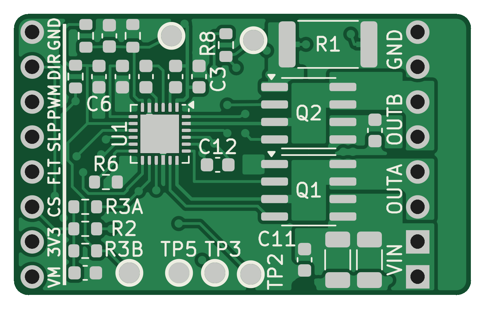
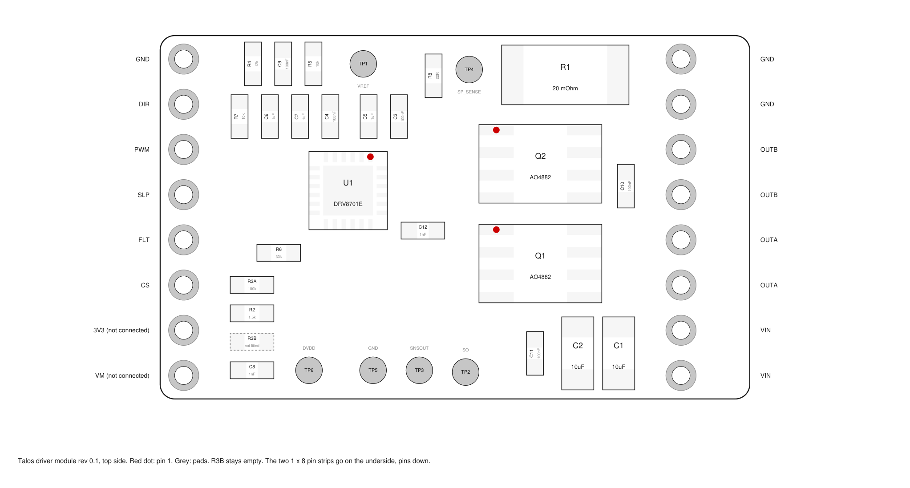

# Talos driver module, rev 0.1

A plug-in motor driver for the [Talos controller board](../talos_controller/README.md). It fits the controller's driver sockets
in place of a Pololu G2 18v17: the same 33 × 20 mm outline, the same sixteen pins, the same meaning on every pin the controller
uses. One module drives one brushed DC motor from the controller's 12 V motor rail. It is built from a TI DRV8701E gate driver,
two AO4882 dual MOSFETs as the H-bridge and a 20 mΩ shunt, all surface-mount on the top side of a two-layer board, so a board
house can build it complete except for the two pin strips.

The reason it exists is cost. The G2 is a 17 A general-purpose driver at about USD 45; a Scorbot joint motor needs 2 to 3 A.
Sized for that, ten assembled modules were quoted by JLCPCB on 13 November 2026 at USD 49.22 on lead-free HASL and USD 64.84 on
ENIG, before shipping: about USD 5 and USD 6.50 a module. A batch of twenty is estimated at about USD 3.40 a module.

> **Status, 13 November 2026.** First design, checked on paper only: design-rule check, the board's connections against the
> schematic, a recalculation of the copper's resistance, loops and heating, and the placement file pad by pad against JLCPCB's own
> footprints. No module has been built, powered or measured, and every figure below is a data-sheet value or an estimate. The
> files are fit for a small prototype batch, not for a robot:
> build a few, run the bench tests in section 6 next to a real G2, and only then put one on an arm. The limits and the open
> questions are in section 7.

Left to right: the logic pin row with a white bar beside it; the passives and the DRV8701E gate driver (U1); the two MOSFET
pairs Q2 and Q1 with the shunt R1 above them and the supply capacitors C1, C2 below; the power pin row. The round pads are test
points.

## What is in this folder

| File | What it is |
| --- | --- |
| `README.md` | this guide |
| `parts.md` | the parts list with the substitution rules |
| `fab/driver_module_rev0.1_gerbers.zip` and `.sha256` | the manufacturing files (Gerbers and drill files) |
| `fab/jlcpcb_bom.csv`, `fab/jlcpcb_cpl.csv` | the BOM and placement files for JLCPCB's assembly service |
| `fab/hand_assembled.csv` | what the assembly service does not place: the pin strips, the spare resistor position, the test pads |
| `schematic.pdf` | the schematic |
| `assembly_map.pdf` | every part's position with its reference and value, pin 1 marks, the pin names |
| `images/` | the board's top and bottom views and the assembly map as pictures |
| `kicad/` | the KiCad project: board, schematic, design rules, the project's footprint library. KiCad 7 format; later versions open and upgrade it |

## How it compares with the Pololu G2 18v17

| | Pololu G2 18v17 | This module |
| --- | --- | --- |
| Outline and pins | 1.3 × 0.8 in, two rows of eight | the same holes and outline |
| Supply | 6.5 to 30 V | the controller's 12 V rail (10 to 13 V); parts rated 40 V or more |
| Continuous current | 17 A | designed for 3 A, unproven: plan on 2 A until test 4 has been run (section 7) |
| Current limit | about 40 A unless a resistor is added | fixed by two resistors: 3.6 A typical, 2.5 to 4.5 A across part tolerances |
| Current-sense pin | about 20 mV/A plus about 50 mV | 19.7 mV/A plus 49 mV, by design |
| Sleep, fault, PWM and direction pins | | the same behaviour by design; the G2's published figures match the same TI driver |
| 3V3 and VM pins | outputs | pins present, not connected |
| Reverse-supply protection | yes | none |
| Over-temperature protection of the MOSFETs | none | none |
| Status | a tested product | untested |

What you give up is headroom and a proven product. The G2's MOSFETs are far larger than a Scorbot needs, which is what makes it
forgiving; this module has a few amps of margin, no more. It suits this controller and these motors, not a general 17 A job.

## 1. Order the boards

Upload `fab/driver_module_rev0.1_gerbers.zip` to JLCPCB as it is (check it against the `.sha256` file if it was copied around).

| Option | Choose |
| --- | --- |
| Layers, size | 2 layers; 33.02 × 20.32 mm is read from the files |
| Thickness, copper | 1.6 mm, 1 oz |
| Colour | green: the Economic assembly service offers ENIG on green boards only |
| Surface finish | ENIG gives flat pads under U1 (0.5 mm pitch) and cost USD 15.62 more for ten in our quote. Lead-free HASL is the cheaper choice and within what JLCPCB states for this pitch |
| Mark on PCB | have the order number left off, or put on the underside; the top has no room for it |
| Quantity | 5 is the minimum for bare boards; the Economic assembly service takes 2 to 50 |

**Assembly.** Tick PCB assembly, Economic, top side. Before paying, check that the quote page says "Economic PCBA Price": our
first quote had slipped to the Standard service, which charged about USD 36 more for the same ten modules. No panel, edge rails or fiducials are needed for a board this size. Upload
`fab/jlcpcb_bom.csv` as the BOM and `fab/jlcpcb_cpl.csv` as the placement file; every BOM line carries a JLCPCB part number.
Three part types are from the Extended library (U1, the MOSFETs, the shunt), which adds a fee per type.

**Check the placement preview before paying.** A chip turned by a quarter turn passes every automatic check and ruins the
batch. In the preview, the pin 1 dot of U1, Q1 and Q2 must sit where `assembly_map.pdf` has its red dots: for U1 the corner
nearest C3, for Q1 and Q2 the pad at the triangle on the silkscreen. The rotations in the placement file were computed from
JLCPCB's own library footprints for these parts (as they were on 13 November 2026), but the preview is the final word. Order the
files as they are: if a part is substituted in the order form, look at the preview again.

## 2. Parts

`parts.md` lists every part. The assembly service fits all of them except the two 1 × 8 pin strips, which you buy and solder
yourself. The position R3B stays empty.

## 3. Assemble

1. Push the two pin strips into a spare socket or a breadboard, long pins down, so they stand square and at the right spacing.
2. Lay the module on them, parts up. The silkscreen names each pin on both sides; the logic row is the side with the small parts.
3. Solder all sixteen pins from the top.
4. Look at the three chips under a magnifier for solder bridges before the first power.

Fitted this way the module stands about 11 mm above the controller, as a G2 on its own headers does.

**Before the first power.** Under a magnifier on every assembled module: U1's dot at the corner nearest C3, the dots of Q1 and Q2
at their triangles, no solder bridge along U1's four rows. With a multimeter: no short from GND to VIN, to OUTA or to OUTB. Then
power it for the first time from a bench supply with a current limit.

**Finding the test pads.** Only TP2, TP3 and TP5 are named on the board. The label "R3B" above the pad at the lower left
belongs to the empty resistor position beside it; that pad is TP6. The assembly map names every pad.

**Plugging a module in.** A module turned round still fits the socket, and so does one shifted by a pin; either destroys it,
or shorts the motor rail, the moment the rail comes on. With the rail off: the logic row (the white bar on the top of the
module runs along it, beside its pin names) goes to the socket's logic row, every pin sits in its own hole with none hanging
out, then power. Pull a module out by its two short ends, where the pins are; three small parts that set the current limit sit
close to one long edge.

## 4. Pins

Logic row, in socket order:

| Pin | Direction | What it does |
| --- | --- | --- |
| GND | | ground, common with the power row |
| DIR | in | direction: high drives OUTA high and OUTB low |
| PWM | in | 3.3 V logic. High drives the motor, low brakes it (both outputs low). 20 kHz in the firmware; the driver accepts up to 100 kHz and 100 % duty |
| SLP | in | low puts the driver to sleep: outputs open, under 15 µA from the rail at room temperature (data sheet). The module has no pull-up; the controller drives the line and holds it low at rest |
| FLT | out | open drain, low while the driver reports a fault. Never driven high; the controller supplies the pull-up |
| CS | out | motor current while driving: 19.7 mV/A plus 49 mV. 0 V while braking and asleep |
| 3V3 | | not connected |
| VM | | not connected |

Power row: GND (two pins), OUTB (two), OUTA (two), VIN (two).

## 5. Firmware

Nothing changes against a G2. The controller firmware keeps its defaults: PWM 20 kHz, current sense 20 mV/A with a 50 mV offset,
and the 5 % minimum duty for a current reading (`SC_PWM_FREQ_HZ`, `SC_CS_MV_PER_A`, `SC_CS_OFFSET_MV`, `SC_CS_MIN_DUTY_PCT` in
`idf.py menuconfig`). Modules and G2s can share a board.

**R3A or R3B.** The current-sense pin needs its 50 mV offset from somewhere. R3A takes it from the PWM pin, so the offset is there
only while the bridge drives and the pin reads 0 V in the PWM off-time: this is what the firmware assumes, and it is the fitted
position. R3B takes it from the driver's 3.3 V supply, so the offset stays through the off-time: this is what TI's data sheet
suggests a real G2 does. Measure a real G2 first (test 1 below). If it holds its offset in the off-time, the firmware's current
model has to change for the G2 anyway, and a batch of modules is then built with R3B fitted instead of R3A. Never fit both.

## 6. Bench tests before first use

Do these with one module and one real G2 side by side in a controller, each on the same type of motor, with a clamp meter on a
motor lead and an oscilloscope. Start from a bench supply with a current limit, not from the ATX supply. Never plug a module
into a live rail. Do the edge check of test 2 at a low current before anything that reaches the current limit (tests 3 to 5).

| Test | What to do | Expect |
| --- | --- | --- |
| 1. Current-sense pin and supply | On the G2 first: scope CS at 25, 50 and 100 % duty, at rest and at 2 A, during the on-time and the off-time. Then the same on the module, up to 4 A. While the module drives 3 A, also scope the supply across its VIN and GND pins | Module: 19.7 mV/A ± 3 % plus 49 mV while driving, under 2 mV in the off-time. Note what the G2 does in the off-time (section 5). Supply at the module: ripple under about 0.1 V at the PWM frequency, ringing of a few tenths of a volt after each edge (estimates); much more means the module needs a capacitor of its own |
| 2. Direction, brake and edges | DIR high and low, PWM at 0, 50 and 100 %. Then, at the current limit, scope U1's pins 18 and 23 (the switch nodes) and pin 21 (the sense input) against U1's centre pad with a short spring ground | Same motor direction as the G2; both outputs low with PWM low. The switch nodes stay above −2 V and the sense input within ±1 V at the edges; if not, the gate drive has to be slowed (R6) before the module is used |
| 3. Current limit | Stall the motor at 100 % duty with a current probe on the lead | The current holds between 2.5 and 4.5 A (3.6 A typical). Write the figure on the module |
| 4. Temperature | 3 A for 30 minutes inside the enclosure, in both directions (DIR low first: it is expected to run hotter), with a thermocouple on Q2's pins 5 and 6, once with warm modules in the neighbouring sockets. Then a 5-minute stall at 70 % duty | MOSFET case under 120 °C; no fault. This test decides the continuous rating. If the stall runs hotter, the firmware's stall detection is what protects the module |
| 5. Faults | From the current-limited supply, with the scope on test pad TP4 (the top of the shunt): short OUTA to OUTB through a switch; lower the supply below 6 V | FLT goes low and the firmware reports a driver fault; FLT releases afterwards; no damage. If TP4 peaks above 1 V in the short, change R8 to 100 Ω before going further |
| 6. Sleep and power-up | Switch SLP a hundred times with the rail on; switch the rail on and off with SLP low and with SLP high; watch FLT on the scope | Outputs open and CS at 0 V asleep. Record every FLT pulse: the driver pulls FLT low while its supply is under about 6 V, and the firmware must not treat that as a fault |
| 7. Back-drive | With SLP low, turn the motor fast by hand | Nothing but a small rise of the rail; module undamaged |

## 7. Limits and open questions

- **Nothing has been built.** The first batch is the first test of every footprint and of the layout.
- **3 A continuous is unproven.** A simple estimate puts the hottest MOSFET junction at about 95 °C at 3 A and 40 °C ambient. A
  model of the routed copper puts it at 105 to 128 °C when no heat leaves through the pins, higher still in dead air between
  neighbours, and at 87 to 102 °C when the pins carry heat into the controller. Neither is a measurement; test 4 is. Until it has
  been run, treat the module as a 2 A part; the controller firmware's per-joint current limits are 1.5 to 2.0 A.
- **The current limit of a given module lies between 2.5 and 4.5 A.** At the top of that range a held stall is estimated to
  overheat the MOSFETs within about two minutes, so the firmware's stall and over-current detection are part of the protection.
- **No over-temperature protection of the MOSFETs.** The driver chip shuts down at 150 °C of its own die only. The G2 is the same.
- **A short from an output to ground is detected only above roughly 28 to 65 A.** A partial short to the robot's frame can destroy a MOSFET
  without a fault report. A short across the motor is detected.
- **No large capacitor on the module.** A G2 carries a 150 µF electrolytic, the tall cylinder on most driver boards. This module
  has only ceramic capacitors (C1, C2, C10, C11) and relies on the controller's four 1000 µF capacitors, which sit on the motor
  rail a few centimetres from the sockets. By estimate the supply ripple at the module is under 0.1 V; test 1 measures it. Used
  anywhere but in this controller, the module needs a few hundred µF close to its VIN and GND pins.
- **No reverse-supply protection.** A bench supply can be connected backwards, and a module plugged in turned round sees the
  rail backwards (section 3). A G2 survives that; this module does not.
- **The FLT line during power-up.** The driver holds FLT low while the motor rail is below about 6 V, which happens at every
  MOTORS ON, e-stop and rail decay. The G2 is expected to do the same. Ignoring FLT while the drives are off is not yet
  implemented in the controller firmware.
- **The current reading includes the ground drop of the socket contacts,** on this module and on a G2 alike. If it matters, the
  cure is a per-board scale in the firmware.
- **Second sources.** The DRV8701E is a TI part with no equivalent. The AO4882 has pin-compatible copies with different
  on-resistance; see `parts.md` before substituting.
