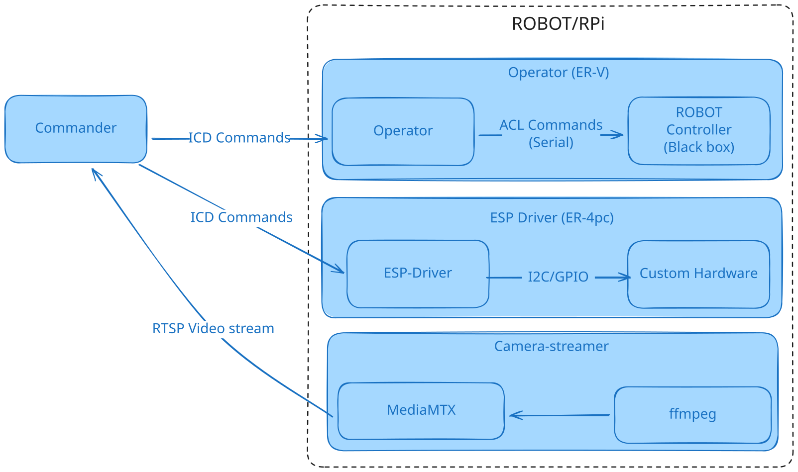

# System Diagram

link: https://excalidraw.com/#json=OaRCIlLSIha3q1zeR-60E,i_1NPVcOt4NHbm6e8J_0Eg

The Talos system has five major subsystems:
1. Commander
2. Pi-Vision
3. Operator
4. ESP Driver (ER-4pc only)
5. Camera Streamer

Operator is strictly restricted to running on the Raspberry Pi. ESP-Driver must run on an ESP32. The other applications can run anywhere. For example, commander can run on the server with GPU, and camera streamer can run on a simple streaming device separate from robot's Raspberry Pi. Commander does not restrict us from pulling video from another source, so this is a completely valid setup. For the time being we are not exhausting resources on the Raspberry Pi, so we are directly streaming out from the Raspberry Pi. We also for ease of use have been running commander off of a laptop.

# [Commander Architecture](commander_architecture.md)
Commander is a python + Javascript controller application that can be run on a wide range of operating systems (even on the robot's Pi!). At the most basic level, it takes the camera feed, interprets where the robot must move and sends commands to the robot over a socket connection. See the architecture doc or Commander's README for more information.

Repository: https://github.com/talos-rit/commander

# [Pi-Vision](https://github.com/talos-rit/pi-vision)
Pi-Vision is an application that runs on each Pi and talks to Operator. It runs the pose & subject detection inference in lieu of Commander as a means of minimizing latency at the cost of some performance.

Repository: https://github.com/talos-rit/pi-vision

# [Operator Architecture](operator_architecture.md)
Operator is on the receiving end of commander. It processes commands, converts them to serial commands compatible for the robot controller (or ESP driver) to understand, and sends them to the robot.

Repository: https://github.com/talos-rit/operator

# [ESP Driver Architecture](esp_driver_architecture.md)
The ESP driver runs on an ESP32 and controls the hardware over GPIO pins/I2C. It replaces the stock Scorbot controller and aims to be a like-for-like replacement (though many ACL commands have yet to be implemented).

Repository: https://github.com/talos-rit/esp-driver

# [ICD Commands](ICD%20API.md)
This is the TCP socket protocol used to communicate between Commander/Pi-Vision and Operator. More info on the format of the data can be found in the linked document. Note, this document outlines the full future spec; not every command is implemented.

# [Camera Streamer](https://github.com/talos-rit/cam_streamer)

This is an installer and setup guide for two services on raspberry pi running linux (Ubuntu or Raspberry Pi OS, or in a Docker container). It packages the following services: MediaMTX and FFmpeg. This is so that we can reliably start up the webcam on startup and keep the stream open for the entire duration that the robot is turned on.

Repository: https://github.com/talos-rit/cam_streamer

# [Gaia](https://github.com/talos-rit/gaia)
Gaia is a developer utility for building and deploying the Talos containers on the Pi's, as well as Commander on your own machine. **In general, if you're developing for Talos, you should probably start by setting up Gaia.**

Repository: https://github.com/talos-rit/gaia